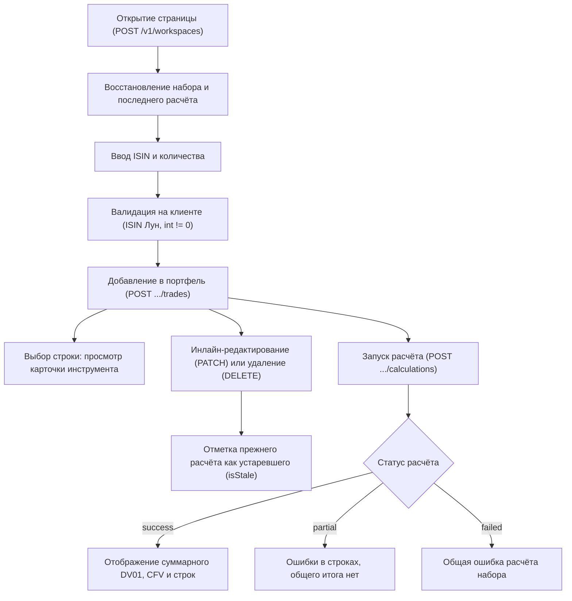

# Техническое задание: Frontend риск-метрик (DV01) для третьего показа

**Спринт:** 30.10–19.11.2026 | **Показ:** 3 («Чайные кони»)
**Статус:** Согласовано (Егор — Frontend / Семён — Backend/API)
**Связанные задачи:** #6 (макеты), #54 / S2-19 (сверка UI/API), #58 (приёмка ТЗ Егором), #59 (состояния данных), #60 (браузерная приёмка).

---

## 1. Назначение и архитектурный контекст

Frontend представляет собой одностраничное веб-приложение (SPA на React 19, TypeScript, Tailwind CSS, Vite) для расчёта метрики процентного риска портфеля облигаций (DV01 — Dollar Value of 01) и справедливой стоимости позиции (Current Fair Value, CFV).

* **Сессионная модель:** Пользователь работает с гипотетическим набором сделок без регистрации. Серверная сессия идентифицируется через HttpOnly Cookie (`session_id`). При открытии страницы сессия создаётся либо восстанавливается (`POST /v1/workspaces`). Независимые вкладки и браузеры изолированы.
* **Защита изменений:** Все мутирующие запросы (`POST`, `PATCH`, `DELETE`) передают токен `X-CSRF-Token` и параметр оптимистической блокировки `expected_revision`.
* **Источники данных:** Мосбиржа (ISS MOEX — параметры облигаций и итоги торгов) и Банк России (ЦБ РФ — официальные курсы валют). Тестовые заглушки (`test`, `demo`) изолированы и в рабочем сценарии не подменяют рыночные данные.

---

## 2. Основной пользовательский сценарий

### 2.1. Ввод ISIN и количества бумаг
* **Поле ISIN (`isin-input`):**
  * Маска: 12 символов `^[A-Z]{2}[A-Z0-9]{9}[0-9]$`. Автоматический перевод в верхний регистр при вводе и обрезка пробелов.
  * Валидация контрольной цифры по стандарту ISO 6166 (алгоритм Луна с буквенными весами). При ошибке блокируется отправка и выводится подсказка: `ISIN: неверная контрольная цифра`.
  * При потере фокуса (`onBlur`) или корректном вводе выполняется автопоиск карточки инструмента (`GET /v1/instruments/{isin}`). Во время запроса внутри поля отображается спиннер.
  * Кнопка быстрой подстановки «Вставить пример (ОФЗ)» заполняет тикер ОФЗ 26238 (`RU000A1038V6`), количество `100` и подтягивает карточку.
* **Поле количества (`quantity-input`):**
  * Целое число (`step=1`), ненулевое ($q \ne 0$), $|q| \le 10^{15}$.
  * Знак определяет позицию: положительное — лонг, отрицательное — шорт (сопровождается поясняющей подписью «Отрицательное = шорт»).
  * Валидация блокирует ввод дробных чисел, нуля и некорректных символов.

### 2.2. Список сделок (портфель)
* Отображает перечень добавленных позиций: тикер ISIN, наименование бумаги (если определено), количество (шорты подсвечиваются красным), кнопки действий.
* Клик по строке делает инструмент активным и загружает его параметры в панель «Справочные данные по инструменту».
* Внизу отображается счётчик позиций («Сделок в портфеле: N»). При пустом списке — заглушка «Нет сделок в портфеле».

### 2.3. Добавление сделки
* Кнопка «Добавить сделку в портфель» отправляет `POST /v1/workspaces/{workspace_id}/trades` с телом `{"isin": "...", "quantity": N, "expected_revision": rev}` и заголовком `X-CSRF-Token`.
* На время запроса кнопка переходит в состояние ожидания («Сохранение…» со спиннером), повторные клики блокируются.
* При успехе форма очищается, список сделок обновляется, новая сделка выбирается в карточке инструмента, ревизия увеличивается на 1.

### 2.4. Редактирование сделки (In-place Edit)
* По нажатию на иконку карандаша количество переходит в режим инлайн-ввода (`input type="number"` с автофокусом).
* Сохранение по нажатию `Enter` или иконки галочки: отправляется `PATCH /v1/workspaces/{workspace_id}/trades/{trade_id}` с `{quantity, expected_revision}`.
* Отмена по нажатию `Escape` или иконки крестика: восстанавливается прежнее значение.

### 2.5. Удаление сделки
* По нажатию на иконку корзины отправляется `DELETE /v1/workspaces/{workspace_id}/trades/{trade_id}?expected_revision={rev}`.
* Позиция удаляется из интерфейса, `revision` обновляется.

### 2.6. Запуск расчёта
* Кнопка «Запустить расчёт риск-метрики» активна только при наличии сделок ($N > 0$) и отсутствии фоновых мутаций.
* Отправляет `POST /v1/workspaces/{workspace_id}/calculations` с `{expected_revision}` (расчёт на текущую дату по умолчанию).
* На время выполнения отображается спиннер и индикатор «Выполняется расчёт DV01 по набору сделок…».

### 2.7. Отображение и чтение результата
* **Статус расчёта:**
  * `success` («Полный расчёт», зелёный бейдж).
  * `partial` («Частичный расчёт», жёлтый бейдж с числом проблемных сделок).
  * `failed` («Ошибка расчёта», красный бейдж).
* **Суммарный итог DV01:**
  * Отображается крупным шрифтом в `RUB` только при `status === 'success'`.
  * Знак: лонг даёт $DV01 < 0$ (падение цены при росте доходности), шорт — $DV01 > 0$.
  * При `partial` и `failed` вместо цифры выводится предупреждение: «Итог не рассчитан: по части сделок нет результата. Причины в столбце «Статус»». Выдуманный ноль не подставляется.
* **Суммарная справедливая стоимость (CFV Total):**
  * Сумма CFV успешных строк выводится в отдельном блоке внизу **только при полном успехе (`success`)**. При частичном расчёте блок скрывается (согласно замечанию F1), чтобы не выдавать неполную сумму за стоимость всего портфеля.
* **Детализация по строкам таблицы:**
  * `ISIN`: тикер + подстрока происхождения данных (источник котировки, дата торгов, курс ЦБ с датой для валютных бумаг).
  * `Кол-во`: число штук с разделением разрядов.
  * `НКД`: величина на одну бумагу с указанием валюты номинала (например, `31.70 RUB` или `3.59 USD`).
  * `CFV (RUB)`: чистая текущая стоимость позиции с учётом знака и курса.
  * `DV01 (RUB)`: значение метрики строки (4 знака после запятой).
  * `Статус`: бейдж «Ок» либо понятное наименование ошибки с тултипом.
* **Карточка инструмента:**
  * Справочные параметры: наименование, валюта номинала, валюта расчётов (если отличается), тип купона (Fixed, Floating, Zero), номинал, чистая цена (% от номинала), НКД, частота выплат, источник и дата котировки.
  * Для плавающего купона (`floating`) выводится пояснение: $D = 1/\text{frequency}$, $C = 0$.

---

## 3. Связь полей интерфейса и контракта API

### 3.1. Эндпоинты

| Действие UI | HTTP метод и URL | Заголовки / Параметры | Тело запроса | Ответ backend |
|---|---|---|---|---|
| Инициализация сессии | `POST /v1/workspaces` | `withCredentials: true` | `{}` | `201 Created` / `200 OK` → `WorkspaceCreated` (id, revision, trades, lastCalculationId, csrfToken) |
| Чтение набора | `GET /v1/workspaces/{id}` | Cookie сессии | — | `200 OK` → `Workspace` |
| Поиск инструмента | `GET /v1/instruments/{isin}` | — | — | `200 OK` → `InstrumentOut` (404 если не найден) |
| Добавление сделки | `POST /v1/workspaces/{id}/trades` | `X-CSRF-Token`, Cookie | `{"isin", "quantity", "expected_revision"}` | `201 Created` → обновлённый `Workspace` |
| Изменение количества | `PATCH /v1/workspaces/{id}/trades/{tid}` | `X-CSRF-Token`, Cookie | `{"quantity", "expected_revision"}` | `200 OK` → обновлённый `Workspace` |
| Удаление сделки | `DELETE /v1/workspaces/{id}/trades/{tid}` | `X-CSRF-Token`, Cookie, Query: `expected_revision` | — | `200 OK` → обновлённый `Workspace` |
| Запуск расчёта | `POST /v1/workspaces/{id}/calculations` | `X-CSRF-Token`, Cookie | `{"expected_revision", "valuation_date"}` | `201 Created` → `CalculationResult` |
| Чтение сохранённого расчёта | `GET /v1/calculations/{id}` | Cookie | — | `200 OK` → `CalculationResult` |

### 3.2. Соответствие полей и единиц измерения

| Концепция | Поле Frontend (`types/api.ts`) | Поле Backend (`schemas/*.py`) | Единицы и правила нормализации |
|---|---|---|---|
| Идентификатор выпуска | `isin` | `isin` | 12 символов, верхний регистр |
| Количество | `quantity` | `quantity` | Целое число штук, $q \ne 0$ |
| Ревизия набора | `revision` / `workspaceRevision` | `revision` / `workspace_revision` | Целое $\ge 0$, автоинкремент при любом изменении набора |
| Валюта номинала | `currency` | `currency` | ISO 4217 (`RUB`, `USD`, `EUR`). Базовая валюта номинала |
| Валюта расчётов | `settlementCurrency` | `settlement_currency` | ISO 4217 (`SUR` переводится в `RUB`). Для замещающих может быть `RUB` при номинале `USD` |
| Номинал бумаги | `nominal` | `nominal_used` | Денежная единица в валюте номинала (на 1 бумагу) |
| Чистая цена | `pricePct` | `price_pct_used` | **Процент от номинала** (напр. `51.577%`). Деление на 100 производит только ядро |
| НКД | `accruedInterest` | `accrued_interest_used` | В валюте номинала на 1 бумагу. Входит в CFV |
| Курс валюты | `fxRateUsed` | `fx_rate_used` | Рублей за 1 единицу валюты номинала (для RUB = 1, источник не опрашивается) |
| Дата котировки | `dataAsOf` | `data_as_of` | Дата торгов Мосбиржи (`YYYY-MM-DD`) |
| Источник котировки | `provider` | `provider` | `moex` (в тестах `test`) |
| Источник курса | `fxSource` | `fx_source` | `cbr` (в тестах `demo`), `null` для RUB |
| Стоимость позиции | `currentFairValue` | `current_fair_value` | $q \times (\text{nominal} \times \frac{\text{price\_pct}}{100} + \text{accrued}) \times \text{fx\_rate}$ в `RUB` |
| Метрика риска | `metricValue` | `metric_value` | $CFV \times (-D \times 10^{-4} + \frac{1}{2} C \times 10^{-8})$ в `RUB` |
| Итог портфеля | `totalValue` | `total_value` | $\sum \text{metric\_value}$ в `RUB`. При ошибках хотя бы одной строки — `null` |

---

## 4. Матрица состояний интерфейса

| Состояние UI | Условие возникновения | Индикация в интерфейсе | Доступные действия пользователя |
|---|---|---|---|
| **Инициализация** | Загрузка приложения, вызов `openWorkspace` | Полноэкранный спиннер «Подключение к серверу…» | Блокировка UI до получения ответа |
| **Отказ подключения** | Сеть недоступна, бэкенд выключен (ERR_NETWORK) | Красный экран ошибки с описанием и кнопкой «Попробовать снова» | Перезагрузка страницы (`window.location.reload()`) |
| **Пустой портфель** | `trades.length === 0` | Заглушка «Нет сделок в портфеле». Кнопка расчёта неактивна (`disabled`) | Ввод ISIN и количества, добавление первой сделки |
| **Поиск инструмента** | Ввод ISIN, запрос к `/instruments/{isin}` | Спиннер в правой части поля ISIN | Ввод количества, отправка формы после окончания поиска |
| **Мутация набора** | Добавление / редактирование / удаление сделки | Спиннер «Сохранение…», отключение кнопок формы и расчёта | Ожидание завершения запроса |
| **Выполнение расчёта** | Нажата кнопка «Запустить расчёт риск-метрики» | Спиннер на кнопке («Выполняется расчёт…») и в панели результатов | Блокировка повторного расчёта и изменения сделок |
| **Полный расчёт (`success`)** | Все строки рассчитаны успешно | Зелёный бейдж «Полный расчёт», крупный итог DV01, блок суммарного CFV | Добавление/правка сделок, выбор строк для инспекции |
| **Частичный расчёт (`partial`)** | Хотя бы одна строка завершилась с ошибкой данных | Жёлтый бейдж «Частичный расчёт (N с ошибкой)», плашка «Итог не рассчитан». **Блок CFV Total скрыт** | Просмотр причин ошибок в таблице, удаление или исправление проблемных сделок |
| **Ошибка расчёта (`failed`)** | Критическая ошибка ядра или источника по всем строкам | Красный бейдж «Ошибка расчёта», итог отсутствует | Анализ ошибок, повторный запуск |
| **Результат устарел (`isStale`)** | Изменение сделки, удаление, добавление или 409: `ws.revision !== calc.workspaceRevision` | Жёлтый бейдж в шапке «Результат устарел», предупреждающий блок над таблицей | Нажатие кнопки «Запустить расчёт риск-метрики» для актуализации |
| **Конфликт версий (409)** | Несовпадение `expected_revision` (параллельная правка) | Сообщение в форме: «Набор изменился. Данные обновлены». Автоматический `getWorkspace` | Продолжение работы с актуализированным набором сделок |
| **Ошибки валидации (422)** | Ошибка формата ISIN или количества от backend | Красные подписи под соответствующими полями формы ввода | Корректировка введённых данных |
| **Серверный сбой (5xx)** | Внутренняя ошибка API | Текст ошибки с указанием `request_id` (например, `... (код запроса 7a1c...)`) | Передача request_id администратору / повтор запроса |

### 4.1. Коды ошибок строки (`RowErrorCode`)

| Код ошибки API | Метка в таблице UI | Тултип / Пояснение пользователю |
|---|---|---|
| `INSTRUMENT_NOT_FOUND` | «Нет выпуска» | Источник не знает такой ISIN |
| `MISSING_MARKET_DATA` | «Нет данных» | У источника нет цены, НКД, дюрации или выпуклости на дату оценки |
| `INCOMPATIBLE_MARKET_DATA` | «Ошибка данных» | Источник вернул несовместимые данные (валюта, единицы или значения $\le 0$) |
| `PROVIDER_UNAVAILABLE` | «Источник недоступен» | Источник рыночных данных (Мосбиржа) не ответил, данных нет |
| `MISSING_FX_RATE` | «Нет курса» | ЦБ РФ не устанавливал курс этой валюты на дату оценки |
| `FX_PROVIDER_UNAVAILABLE` | «Курсы недоступны» | Источник курсов валют (ЦБ РФ) не ответил, сохранённого курса нет |

---

## 5. Контрольный пример третьего показа (на реальных параметрах Мосбиржи и ЦБ)

Дата оценки: **13.11.2026** (пятница). Проверено автоматическими тестами `backend/tests/test_control_moex_cbr.py` и `frontend/tests/verification.test.ts`.

| Параметр | Позиция 1: ОФЗ 26238 | Позиция 2: ГазКЗ-34Д | Итог портфеля |
|---|---|---|---|
| **ISIN / Тип** | `RU000A1038V6` (ОФЗ, фиксированный) | `RU000A105A95` (Замещающая USD, фикс.) | 2 сделки |
| **Количество ($q$)** | **+100** шт. (лонг) | **−10** шт. (шорт) | — |
| **Валюта номинала / расчётов** | RUB / RUB | USD / RUB (режим TQCB) | — |
| **Номинал** | 1 000 ₽ | 1 000 $ | — |
| **Цена закрытия (`LEGALCLOSEPRICE`)** | 51.577 % | 96.2999 % | — |
| **НКД на дату торгов (`ACCINT`)** | 31.70 ₽ | 3.59 $ (из режима TQOD) | — |
| **Курс ЦБ к рублю** | 1.0000 ₽ | 82.9803 ₽ (курс на 13.11.2026) | — |
| **Модифицированная дюрация ($D$)** | 5.768382680528 | 5.176459212386 (база 360) | — |
| **Выпуклость ($C$)** | 58.553339735139 | 36.691611768865 | — |
| **Стоимость позиции (CFV)** | $100 \times (1000 \times 0.51577 + 31.70) =$ **54 747.00 ₽** | $-10 \times (962.999 + 3.59) \times 82.9803 =$ **−802 078.45 ₽** | **−747 331.45 ₽** |
| **DV01 позиции** | $54747 \times (-5.7684 \cdot 10^{-4} + \frac{58.553}{2} \cdot 10^{-8}) =$ **−31.5641 ₽** | $-802078.45 \times (-5.1765 \cdot 10^{-4} + \frac{36.692}{2} \cdot 10^{-8}) =$ **+415.0455 ₽** | **+383.4814 ₽** |
| **Статус строки** | `success` («Ок») | `success` («Ок») | `success` («Полный расчёт») |

> [!NOTE]
> Значения получены на записанных официальных параметрах торгов и независимой арифметике. Независимый эталон эксперта с предельным допуском погрешности запрошен в задаче #15.

---

## 6. Согласование Егора и Семёна (UI ↔ API)

В рамках подготовки к третьему показу (задачи #54 / S2-19, #58, #59) устранены все выявленные расхождения контракта:

* **F1 (Устранено):** При статусе `partial` суммарный блок CFV скрывается. Пользователь видит CFV только в разрезе конкретных строк, что предотвращает неверную оценку неполного портфеля.
* **F2 (Устранено):** Расширено перечисление `RowErrorCode`. Вместо обобщённого «Нет данных» интерфейс чётко различает недоступность биржи, отсутствие курса валюты в ЦБ РФ и ошибки несовместимости данных.
* **F3 (Устранено):** В интерфейс добавлены сведения о происхождении данных: источник котировки, дата торгов, курс ЦБ и дата курса, а также явное разделение валюты номинала и валюты расчётов. Реализован проброс `request_id` при серверных сбоях.
* **F4 (Устранено):** Состояние устаревания (`isStale`) привязано к сопоставлению `workspace.revision !== calcResult.workspaceRevision`. Работает консистентно при локальных правках и после разрешения конфликтов 409.
* **Замечания по макетам (#6):**
  * Реализована 12-колоночная адаптивная компоновка: компактный блок управления и список сделок слева (5 колонок), развёрнутые справочные данные и таблица результатов справа (7 колонок).
  * Финансовые поля и тикеры переведены на моноширинный шрифт (`font-mono`) с табулированным выравниванием чисел по правому краю.
  * Цветовое кодирование строго соответствует риск-методологии: отрицательный DV01 (лонг) и положительный (шорт) подсвечиваются контрастно.

---

## 7. Разграничение: Обязательные требования vs Оставшийся бэклог vs Эксперименты

### 7.1. Входит в обязательные требования 3-го показа (Done & Verified)
1. Полный жизненный цикл сделок (CRUD) в изолированной сессии.
2. Проверка корректности ввода (маска ISIN, алгоритм Луна, целое ненулевое количество).
3. Интеграция с контрактом backend: заголовки CSRF, ревизии, оптимистическая блокировка 409.
4. Расчёт DV01 и CFV на реальных адаптерах Мосбиржи и ЦБ РФ.
5. Корректное отображение полного (`success`), частичного (`partial`) расчёта и ошибок строк без подмены нулями.
6. Вычисление и отображение устаревания результатов при любых изменениях состава портфеля.
7. Восстановление состояния портфеля и последнего расчёта при перезагрузке страницы (`last_calculation_id`).

8. Автоматизация сквозного браузерного E2E-сценария (Playwright, `portfolio.spec.ts`, задача #60).

### 7.2. Оставшиеся системные требования (Отдельный бэклог)
* **Задача #15:** Получение официального эталона эксперта с предельным допуском (текущие значения являются эталоном команды по реальным параметрам биржи).
* **UI-выбор исторической даты оценки (`valuation_date`):** API параметр поддерживает, в текущем UI расчёт инициируется на текущую дату.
* **Экран полной истории расчётов:** API сохраняет все запуски, но текущий интерфейс показывает последний актуальный расчёт набора.

### 7.3. Необязательные эксперименты интерфейса (Отделены от базового ТЗ)
Следующие элементы признаны факультативными экспериментами и **не входят** в обязательную приёмку:
* Интерактивные графики кривой бескупонной доходности (КБД) и профилей доходности.
* Моделирование стресс-сценариев сдвига кривой (слайдер $\pm 100$ bp в реальном времени).
* Импорт/экспорт сделок через CSV/Excel файлы и Drag-and-drop.
* Переключатель светлой/тёмной темы интерфейса.
* Сложные каскадные анимации появления строк.
